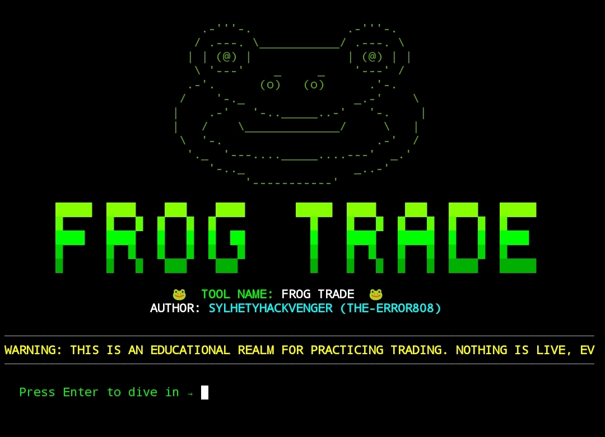
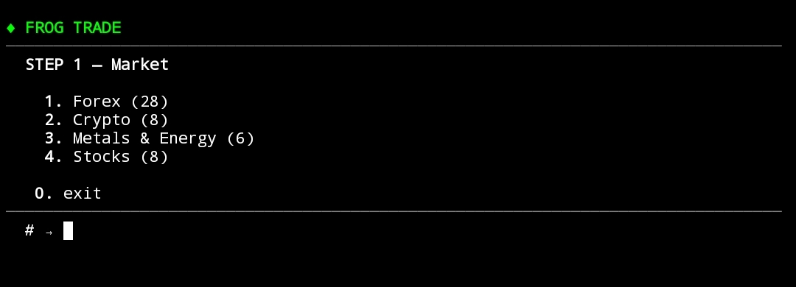
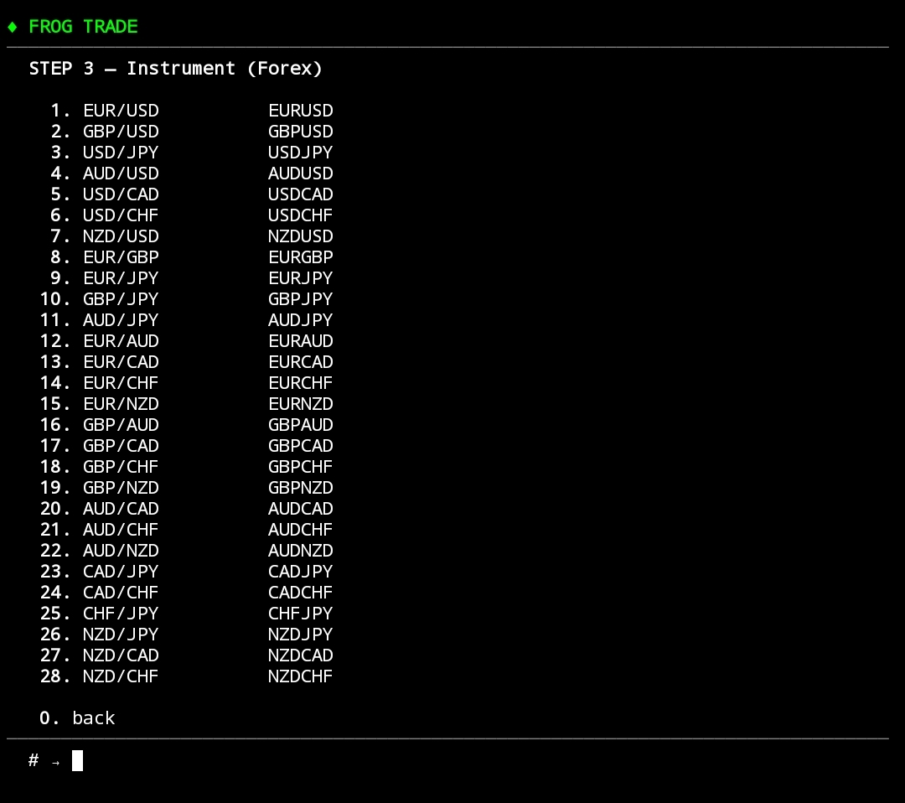
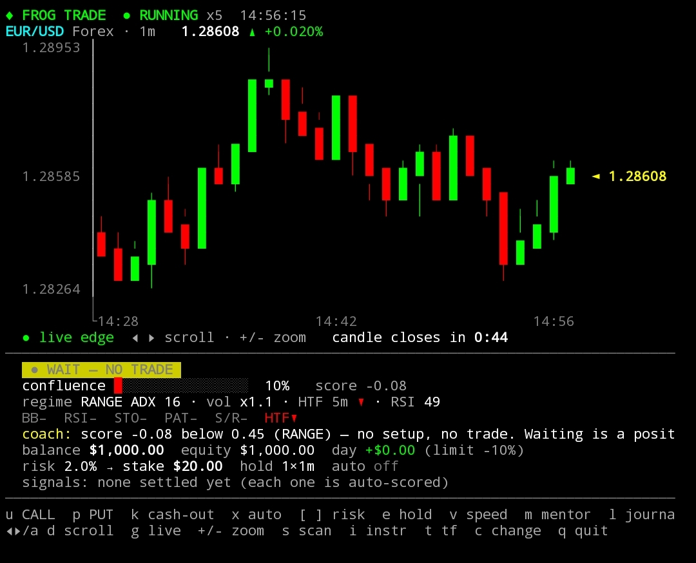
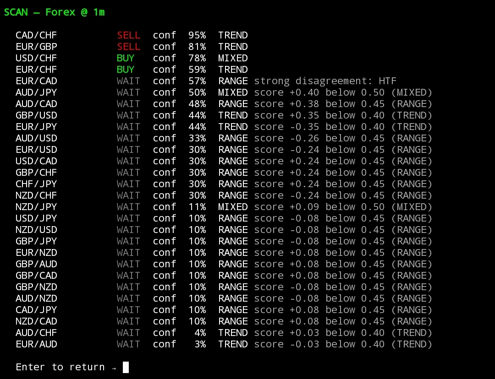
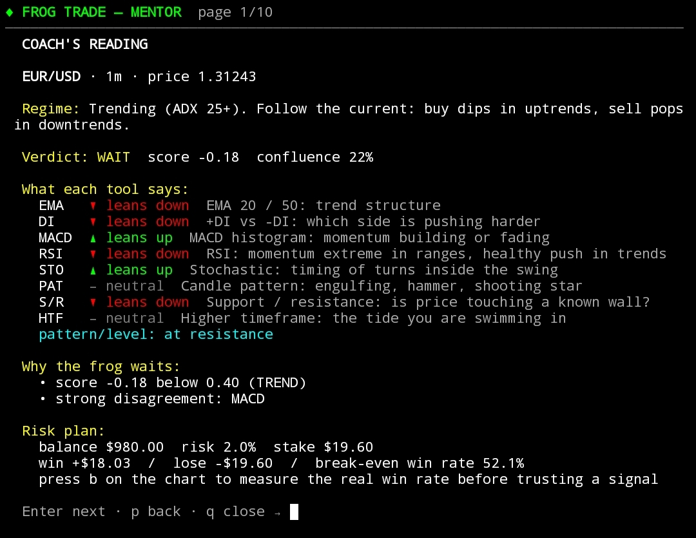
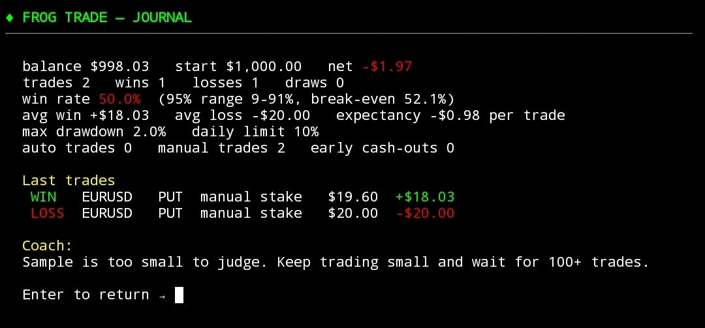

<p align="center">
  
</p>

FROG TRADE — A professional-grade, terminal-based trading laboratory disguised as a procrastination engine.

AUTHOR: SYLHETYHACKVENGER (THE-ERROR808)
STATUS: 🟢 Educational realm — everything is fictional, nothing is live
PLATFORM: Termux / Linux / macOS / Windows (ANSI 24-bit color terminal)
LANGUAGE: Pure Python 3 — zero external dependencies
PHILOSOPHY: Dive. Survive. Strike again.

---

⚠️ NOTICE — READ FIRST

```
WARNING: THIS IS AN EDUCATIONAL REALM FOR PRACTICING TRADING.
NOTHING IS LIVE, EVERYTHING IS FICTIONAL.
```

FROG TRADE is a simulated trading laboratory. There is no broker connection, no API keys, no real money, and no data feed. Every price is generated by a deterministic synthetic market engine running inside your terminal. The purpose is to train your reflexes, your discipline, and your risk awareness — not to make you money.

If you are looking for a "trading bot that prints money," close this tab. The frog only helps those who help themselves.

---

📖 Table of Contents

1. What Is FROG TRADE?
2. Why "Pro Procrastinators"?
3. Feature Matrix
4. Installation — Termux
5. Installation — Linux / macOS / WSL
6. Installation — Windows
7. Quick Start
8. The Wizard (Step 1 → Step 3)
9. The Chart Interface
10. Keyboard Reference
11. The Analysis Engine
12. Market Regimes — TREND / MIXED / RANGE
13. The Vote System
14. Blockers — Why the Frog Waits
15. Risk Management System
16. Position Sizing Math
17. The Payout Reality
18. Backtesting Module
19. Signal Tracker
20. The Journal (CSV)
21. Auto-Follow Mode
22. Cash-Out Mechanics
23. The Mentor (9 Lessons)
24. The Coach's Reading
25. Scan Mode
26. The Intro Animation
27. Market Catalogue
28. Environment Variables
29. Configuration Constants
30. Architecture Overview
31. The Synthetic Feed (SimFeed)
32. Candle Generation Model
33. Timeframe System & HTF Mapping
34. Indicator Implementations
35. The Rendering Pipeline
36. The Frog Animation (Scene)
37. Terminal Compatibility
38. Troubleshooting
39. Learning Path — 30-Day Curriculum
40. Common Beginner Traps
41. Advanced Tips
42. FAQ
43. Roadmap
44. Credits & Author
45. License & Disclaimer

---

🐸 What Is FROG TRADE?

FROG TRADE is a terminal-native binary-options-style trading simulator designed for people who:

· Want to practice reading charts without risking capital
· Want to build discipline around risk management
· Want to understand why most retail traders lose (spoiler: it's the payout math)
· Want to procrastinate productively instead of doom-scrolling

It ships as a single Python file (frogtrade.py) with no dependencies beyond the Python 3 standard library. It runs entirely in the terminal, uses ANSI 24-bit color, and includes a hand-rendered frog that dives into a pond to catch a dragonfly — because every trading platform needs a mascot.

The Core Premise

You start with $1,000 of fictional money. You can trade 28 forex pairs, 8 crypto pairs, 6 metals/energy instruments, and 8 stocks across 6 timeframes. Each trade is a binary outcome: you win 92% of your stake, or you lose 100% of it. This payout structure is realistic for binary options and is the entire point — it teaches you that you need a win rate above 52.1% to break even.

The frog does not let you cheat. It will block trades when:

· The signal score is below the regime threshold
· Fewer than 4 indicators agree
· A strong indicator disagrees
· The higher timeframe is against you
· Volatility is too low or too high
· There's a spike candle
· RSI is overextended
· You've hit your daily loss limit
· You're in a cool-down after 3 losses

The frog is a coach, not a cheerleader.

---

🎮 Why "Pro Procrastinators"?

Because the most dangerous thing in trading is boredom. Boredom makes you overtrade. Overtrading makes you bleed. FROG TRADE is designed to keep you entertained while learning — the frog animation, the live chart, the mentor lessons, the backtest button, the scan mode. Every feature exists to keep you in the lab instead of in a live account.

The tagline is:

"A game based trading tool made for pro procrastinators."

You will spend hours here. You will learn. And you will lose fake money instead of real money while you do it.

---

📊 Feature Matrix

Feature Status Notes
Synthetic market engine ✅ 50 instruments, 6 timeframes
Live candlestick chart ✅ Braille-style block rendering
8 indicators ✅ EMA, RSI, MACD, Stochastic, ADX, ATR, Bollinger %B, S/R
Candle patterns ✅ Engulfing, hammer, shooting star
Higher-timeframe bias ✅ Auto-mapped HTF per timeframe
Confluence scoring ✅ Weighted vote system
Blockers / coach ✅ Explains every WAIT
Manual trading ✅ CALL / PUT
Auto-follow mode ✅ Trades signals automatically
Cash-out early ✅ Partial payout mechanic
Risk % control ✅ 0.5% – 5.0%
Hold time control ✅ 1× / 2× / 3× candles
Daily loss limit ✅ 10% hard guard
Cool-down after losses ✅ 3 losses → 3 candles
Signal tracker ✅ Auto-scored every signal
Backtest module ✅ Wilson 95% confidence interval
CSV journal ✅ frogtrade_journal.csv
Mentor (9 lessons) ✅ Reading + theory
Scan mode ✅ All instruments in a market
Frog intro animation ✅ 6-second pond dive
Speed control ✅ 1× / 5× / 15× / 60×
Chart scroll & zoom ✅ Keyboard navigation
Multi-market wizard ✅ Forex / Crypto / Metals / Stocks

---

📦 Installation — Termux

Termux is the primary target platform. FROG TRADE runs beautifully on Android.

Step 1 — Update Termux

```bash
pkg update && pkg upgrade -y
```

Step 2 — Install Python

```bash
pkg install python -y
```

Step 3 — (Optional) Install termux-api for better terminal handling

```bash
pkg install termux-api -y
```

Step 4 — Download FROG TRADE

```bash
mkdir -p ~/frogtrade && cd ~/frogtrade
# Place frogtrade.py in this folder
```

Step 5 — Run

```bash
python frogtrade.py
```

Recommended Termux Setup

· Font: Termux default (monospace) works best
· Terminal size: At least 80×30, ideally 100×40
· Orientation: Landscape recommended on phones
· Battery: Disable battery optimization for Termux if animations stutter

Termux-Specific Notes

· The intro animation uses 24-bit ANSI color. Termux supports this by default.
· If colors look wrong, run: echo $TERM — it should be xterm-256color.
· To skip the intro on every launch: export FROG_SKIP_INTRO=1
· To make it permanent, add to ~/.bashrc:
  ```bash
  echo 'export FROG_SKIP_INTRO=1' >> ~/.bashrc
  ```

---

🐧 Installation — Linux / macOS / WSL

Linux

```bash
sudo apt update && sudo apt install python3 -y   # Debian/Ubuntu
python3 frogtrade.py
```

macOS

```bash
brew install python3   # if not already installed
python3 frogtrade.py
```

WSL (Windows Subsystem for Linux)

```bash
sudo apt update && sudo apt install python3 -y
python3 frogtrade.py
```

WSL note: Use Windows Terminal, not the legacy console, for correct 24-bit color and Unicode block rendering.

---

🪟 Installation — Windows

Option A — Native Python

1. Install Python 3.9+ from python.org
2. Open PowerShell or Windows Terminal
3. Run:
   ```powershell
   python frogtrade.py
   ```

Option B — WSL (recommended)

See the WSL section above. WSL gives you the best rendering.

Windows Console Notes

· FROG TRADE calls os.system("") on Windows to enable ANSI escape sequences.
· Windows Terminal is strongly recommended over cmd.exe.
· If arrow keys don't work, ensure you're in a terminal that sends ANSI escape codes (Windows Terminal does; legacy cmd may not).

---

🚀 Quick Start

```bash
# 1. Run the tool
python frogtrade.py

# 2. Watch the intro (or press Ctrl+C to skip)

# 3. Press Enter at the banner

# 4. Choose a market:  1 = Forex, 2 = Crypto, 3 = Metals, 4 = Stocks
# 5. Choose a timeframe:  1 = 1m, 2 = 5m, 3 = 15m, 4 = 30m, 5 = 1h, 6 = 4h
# 6. Choose an instrument (e.g., 1 = EUR/USD)

# 7. You're live. Watch the chart. Wait for the frog to say BUY or SELL.

# 8. Press u to place a CALL (buy) or p to place a PUT (sell)

# 9. Press k to cash out early, or wait for expiry

# 10. Press m to open the mentor. Read every lesson.
```

Your First 5 Minutes

1. Let the chart fill with ~120 candles (takes ~30 seconds at 5× speed).
2. Wait for a green BUY or red SELL badge to appear.
3. Press u or p immediately — late entries are flagged and lose edge.
4. Watch the trade resolve. Win → +0.92× stake. Lose → −1.00× stake.
5. Press b to backtest the current instrument. Look at the 95% range.
6. Press m and read Lesson 2 — The Payout Math. This is the most important lesson.

---

🧙 The Wizard (Step 1 → Step 3)

FROG TRADE opens with a 3-step wizard. It's intentionally simple.

Step 1 — Market

```
STEP 1 — Market
  1. Forex (28)
  2. Crypto (8)
  3. Metals & Energy (6)
  4. Stocks (8)
  0. exit
```

Step 2 — Timeframe

```
STEP 2 — Timeframe
  1. 1m   (60s candles)
  2. 5m   (300s candles)
  3. 15m  (900s candles)
  4. 30m  (1800s candles)
  5. 1h   (3600s candles)
  6. 4h   (14400s candles)
  0. back
```

Step 3 — Instrument

```
STEP 3 — Instrument (Forex)
  1. EUR/USD          EURUSD
  2. GBP/USD          GBPUSD
  ...
```

Exiting the Wizard

Type 0 at any step. From Step 1, 0 exits the program. From Step 2 or 3, 0 goes back one step.

---

📈 The Chart Interface

```
◆ FROG TRADE  ● RUNNING 5x 14:32:07
EUR/USD · Forex 5m   ·   1.08432  ▲ +0.021%
                                              ╷
         █                                    ╷
         █   ╷                                ╷
    ╷    █   █   ╷                            ╷
    █    █   █   █        ╷                   ╷    1.0850
    █    █   █   █   ╷    █                   ╷
    ╵    ╵   ╵   ╵   █    █                   ╷
                    ╵    ╵                   ╷
                                              ╷
  ● live edge  ◀ ▶ scroll · +/- zoom   candle closes in 0:42
──────────────────────────────────────────────────────
  ● WAIT — NO TRADE
  confluence ███░░░░░░░░░░░░░  34%   score +0.21
  regime MIXED ADX 22 · vol x1.0 · HTF 15m – · RSI 54
  EMA▲  DI▲  MACD–  RSI–  STO–  PAT–  S/R–  HTF▲
  coach: score +0.21 below 0.50 (MIXED) — no setup, no trade. Waiting is a position.
  balance $1,000.00  equity $1,000.00  day +$0.00 (limit -10%)
  risk 2.0% → stake $20.00  hold 1×5m  auto off
  signals: none settled yet (each one is auto-scored)
──────────────────────────────────────────────────────
u CALL  p PUT  k cash-out  x auto  [ ] risk  e hold  v speed  m mentor  l journal  b backtest
◀▶/a d scroll  g live  +/- zoom  s scan  i instr  t tf  c change  q quit
```

Anatomy of the Header

· ◆ FROG TRADE — tool name
· ● RUNNING 5x — green dot = live feed; 5x = clock speed
· 14:32:07 — simulated clock
· EUR/USD · Forex 5m — instrument and timeframe
· 1.08432 ▲ +0.021% — last price and candle change

Anatomy of the Chart

· Green blocks = bullish candle (close ≥ open)
· Red blocks = bearish candle (close < open)
· Wicks = high/low range
· Right-side price labels = 3 reference prices (top / mid / bottom of visible range)
· ◄ 1.08432 = current price marker (only when scrolled to live edge)
· Signal markers below the chart:
  · ▲ green = BUY signal that won
  · ▼ red = SELL signal that lost
  · ▲/▼ yellow = unsettled signal

Anatomy of the Analysis Panel

· Badge — BUY / CALL, SELL / PUT, or WAIT — NO TRADE
· Confluence bar — 0–100%, visual strength of the signal
· Score — weighted vote average (−1.0 to +1.0)
· Regime — TREND / MIXED / RANGE
· ADX — trend strength
· Vol — ATR ratio vs. median (1.0 = normal)
· HTF — higher timeframe bias (▲ / ▼ / –)
· RSI — momentum reading
· Vote row — every indicator's lean (▲ up, ▼ down, – neutral)
· Coach — one-line explanation of the current state

---

⌨️ Keyboard Reference

Trading

Key Action
u Place CALL (bet price goes up)
p Place PUT (bet price goes down)
k Cash out all open trades early
x Toggle auto-follow mode
[ Decrease risk by 0.5% (min 0.5%)
] Increase risk by 0.5% (max 5.0%)
e Cycle hold time: 1× → 2× → 3× candles
v Cycle clock speed: 1× → 5× → 15× → 60×

Chart Navigation

Key Action
← / a Scroll left 3 bars
→ / d Scroll right 3 bars
PgUp Scroll left one page
PgDn Scroll right one page
Home Jump to oldest history
End / g Jump to live edge
+ / = / ↑ Zoom in (wider candles)
- / _ / ↓ Zoom out (narrower candles)

Tools

Key Action
b Run backtest on current instrument
m Open mentor (reading + 9 lessons)
l Open journal report
s Scan all instruments in current market
i Change instrument
t Change timeframe
c Change market (full wizard)
Enter Force immediate refresh
q / Ctrl+C Quit (auto-cashes out all open trades)

Universal

Key Action
Ctrl+C Quit safely from any screen

---

🧠 The Analysis Engine

The heart of FROG TRADE is the analyze() function. It takes closed candles, computes every indicator, and produces an Analysis object with:

· verdict — BUY, SELL, or WAIT
· score — weighted vote average (−1.0 to +1.0)
· confluence — 0–100% strength
· regime — TREND, MIXED, or RANGE
· votes — per-indicator lean
· blockers — reasons the frog refuses to trade
· htf — higher timeframe bias
· atr_ratio — volatility vs. median
· rsi — current RSI

The Pipeline

```
closed candles (≥ 120 required)
        │
        ├─► ATR (14) ────────► volatility check
        ├─► ADX (14) ────────► regime classification
        ├─► RSI (14) ────────► momentum
        ├─► MACD (12,26,9) ──► momentum building/fading
        ├─► Stochastic (14) ─► timing of turns
        ├─► Bollinger %B (20) ► range extremes
        ├─► EMA (20, 50) ────► trend structure
        ├─► Candle pattern ──► engulfing / hammer / star
        ├─► S/R detection ───► swing highs/lows
        └─► HTF bias ────────► resampled higher timeframe
                │
                ▼
        weighted vote → score
                │
                ▼
        blocker checks → verdict
```

---

🌊 Market Regimes — TREND / MIXED / RANGE

FROG TRADE classifies the market using ADX (14):

ADX Regime What it means
≥ 25 TREND Strong directional push. Follow the current.
20–25 MIXED Transition. The frog is picky.
≤ 20 RANGE Price oscillates. Fade the extremes.

Why This Matters

Different indicators work in different regimes. Using trend tools (EMA, MACD) in a range is the classic beginner leak. FROG TRADE uses different vote sets per regime:

In TREND:

· EMA (weight 3) — trend structure
· DI (weight 1.5) — directional pressure
· MACD (weight 2) — momentum
· RSI (weight 1.5) — healthy push vs. exhaustion
· Stochastic (weight 1.5) — timing of pullback entries
· Pattern (weight 1.5)
· S/R (weight 1.5)
· HTF (weight 3) — the tide

In RANGE:

· Bollinger %B (weight 3) — band extremes
· RSI (weight 2.5) — oversold/overbought
· Stochastic (weight 2) — cross timing
· Pattern (weight 2)
· S/R (weight 2) — walls
· HTF (weight 1) — less important in ranges

In MIXED: uses the TREND vote set, but with a higher threshold (0.50 vs. 0.40).

---

🗳️ The Vote System

Each indicator casts a vote between −1.0 and +1.0:

· +1.0 = strong bullish
· +0.4 to +0.6 = mild bullish
· 0.0 = neutral
· −0.4 to −0.6 = mild bearish
· −1.0 = strong bearish

Each vote is multiplied by its weight. The score is:

```
score = Σ(vote × weight) / Σ(weight)
```

The direction is +1 if score > 0, else −1.

The agreement count counts how many votes lean at least 0.4 × direction.

The engine requires at least 4 agreeing votes to consider a trade.

---

🚧 Blockers — Why the Frog Waits

A trade is blocked if any of these fire:

Blocker Condition
Low score abs(score) < THRESH[regime]
Low agreement agree < 4
Strong disagreement Any indicator votes ≤ −0.7 × direction
HTF against htf_bias == −direction
Too quiet atr_ratio < 0.5
Volatility spike atr_ratio > 2.2
Spike candle Last candle range > 3 × ATR
Overextended RSI > 75 (long) or RSI < 25 (short)

When a blocker fires, the verdict is WAIT and the first blocker is shown in the coach line:

```
coach: score +0.21 below 0.50 (MIXED) — no setup, no trade. Waiting is a position.
```

This is the most important part of the tool. The frog is not a signal generator — it's a filter. Most of the time it says WAIT. That's correct.

---

🛡️ Risk Management System

FROG TRADE enforces three layers of risk control:

Layer 1 — Stake Sizing

```python
stake = max(1.0, round(balance × risk_pct / 100, 2))
```

Default: 2%. Range: 0.5% – 5.0%.

Layer 2 — Daily Loss Limit

```python
halted = (day_start - equity) >= day_start × DAILY_LIMIT / 100
```

Default: 10%. When hit, all trading is blocked until the program restarts.

Layer 3 — Cool-Down After Losses

```python
if streak <= -3:
    cool_until = now + 3 × tf
    streak = 0
```

Three consecutive losses trigger a 3-candle cool-down. During cool-down, every trade attempt is rejected with a message.

Layer 4 — Max Open Trades

```python
if len(open) >= MAX_OPEN:   # MAX_OPEN = 2
    block
```

You can't spam entries. Two open trades max.

Layer 5 — Drawdown Tracking

The account tracks peak and max_dd (maximum drawdown %) across the session. Shown in the journal report.

---

🧮 Position Sizing Math

At 2% risk on $1,000**, your stake is **$20.

Outcome Payout Net
Win $18.40 (92%) +$18.40
Loss $0 −$20.00
Draw $20.00 (stake back) $0.00

Streak Math

Losses in a row Balance after (2%) Balance after (20%)
3 $942 $512
5 $904 $328
10 $817 $107
15 $739 $35

This is why the tool defaults to 2%. Ten losses in a row at 2% is survivable. Ten at 20% is game over.

---

💰 The Payout Reality

The payout is 92% (PAYOUT = 0.92).

The break-even win rate is:

```
BREAKEVEN = 100 / (1 + 0.92) = 52.08%
```

You need to win 52.1% of your trades just to break even.

At 55% win rate:

```
EV = 0.55 × 0.92 − 0.45 × 1.00 = +0.056 per $1 staked
```

At 50% win rate:

```
EV = 0.50 × 0.92 − 0.50 × 1.00 = −0.04 per $1 staked
```

This is the entire point of the tool. Most retail traders win 45–50% of the time and wonder why they bleed. The frog teaches you this in Lesson 2.

---

🔬 Backtesting Module

Press b on the chart to run a backtest on the current instrument.

What It Does

1. Takes the last 450 closed candles
2. Runs analyze() on every candle from index MIN_BARS onward
3. For each non-WAIT signal, checks the next candle:
   · Next candle bullish + BUY → WIN
   · Next candle bearish + SELL → WIN
   · Otherwise → LOSS
   · Doji → DRAW
4. Computes Wilson 95% confidence interval on the win rate

The Wilson Interval

The Wilson score interval is a better confidence interval than the naive p ± 1.96 × sqrt(p(1−p)/n) for small samples and extreme proportions. FROG TRADE uses it to show how uncertain the win rate is.

Example output:

```
backtest 87 trades in 450 bars · 56.3% (95% range 46–66%) · edge NOT proven
```

The low end (46%) is below break-even (52.1%). So even though the raw win rate is 56.3%, the edge is not statistically proven — the sample is too small.

This is the most important statistical lesson in the tool. Most "trading gurus" show you a 60% win rate on 20 trades. The Wilson interval shows you that's noise.

Trust Rule

Only trust an edge when the low end of the 95% range clears break-even.

---

📡 Signal Tracker

Every time the frog produces a non-WAIT signal at candle close, the Tracker records it:

```python
{sigs[an.time] = {"dir": "BUY"/"SELL", "entry_t": an.time + tf, "result": None}}
```

When the entry candle closes, the signal is auto-scored:

· WIN — entry candle closed in the signal's direction
· LOSS — entry candle closed against the signal
· DRAW — doji

The scoreboard at the bottom shows:

```
signals 12W / 8L / 1D  60% (need 52.1% · net +3.04u)
```

This is honest feedback. You can't hide from it. Every signal is scored, journaled, and displayed.

---

📓 The Journal (CSV)

Every signal and every trade is appended to:

```
frogtrade_journal.csv
```

Columns

Column Meaning
time UTC timestamp (ISO 8601)
source signal, manual, or auto
symbol Instrument code (e.g., EURUSD)
tf Timeframe in seconds
dir BUY or SELL
stake Stake amount
entry Entry price
exit Exit price
result WIN / LOSS / DRAW / CASH
pnl Profit/loss in dollars

Open in Excel / LibreOffice

```bash
libreoffice --calc frogtrade_journal.csv
```

Or analyze with Python:

```python
import csv
with open("frogtrade_journal.csv") as f:
    rows = list(csv.DictReader(f))
wins = [r for r in rows if r["result"] == "WIN"]
print(f"{len(wins)} wins / {len(rows)} signals")
```

---

🤖 Auto-Follow Mode

Press x to toggle auto-follow.

When ON, every new signal is automatically traded at the next candle open. The stake follows your risk %.

When to Use It

· Testing a strategy — let the engine trade for 50+ signals, then review the journal
· Learning by observation — watch what the engine does, don't interfere
· Procrastination — let it run in the background while you read the mentor

When NOT to Use It

· Real money — never, ever
· When you're learning — manual trading forces you to think

Auto-Follow Logging

Auto trades are tagged source=auto in the journal. The report shows auto vs. manual trade counts separately.

---

💵 Cash-Out Mechanics

Press k to cash out all open trades before expiry.

Cash-Out Value Formula

```python
span = t1 - t0
prog = clamp((now - t0) / span, 0, 1)

if price == entry:
    return stake × 0.9          # 90% back on flat
elif winning:
    return stake × (1 + PAYOUT × (0.35 + 0.45 × prog))
else:
    return stake × (0.55 - 0.35 × prog)
```

Interpretation

State Early Exit Value
Flat, just opened 90% of stake
Winning, 0% progress 35% of max payout
Winning, 100% progress 80% of max payout
Losing, 0% progress 55% of stake
Losing, 100% progress 20% of stake

Cash-out always gives up edge. The only reason to use it is to lock in a winner before a volatile candle closes against you.

---

📚 The Mentor (9 Lessons)

Press m to open the mentor. The first page is the Coach's Reading — a live analysis of the current instrument. Then 9 lessons:

1. The Frog's First Law: Survive — capital preservation
2. The Payout Math — why 52.1% is the magic number
3. Position Sizing — 2% vs. 20%
4. Loss Limits and Cool-downs — why revenge trading kills
5. Read the Regime First — trend vs. range
6. Confluence, Not Hope — why 4 indicators matter
7. Timing, Holding and Cashing Out — entry/exit mechanics
8. Journal and Judge by Numbers — Wilson intervals
9. When to Dive — the patience doctrine

Each lesson is short, direct, and actionable. Read them all before you trade with real money — if you ever do.

---

🧑‍🏫 The Coach's Reading

Press m and the first page is a live analysis of the current instrument:

```
COACH'S READING

EUR/USD · 5m · price 1.08432

Regime: Transition (ADX 20-25). The frog is picky here and needs more agreement.

Verdict: WAIT  score +0.21  confluence 34%

What each tool says:
  EMA   ▲ leans up    EMA 20 / 50: trend structure
  DI    ▲ leans up    +DI vs -DI: which side is pushing harder
  MACD  – neutral     MACD histogram: momentum building or fading
  RSI   – neutral     RSI: momentum extreme in ranges, healthy push in trends
  ...

Why the frog waits:
  • score +0.21 below 0.50 (MIXED)

Risk plan:
  balance $1,000.00  risk 2.0%  stake $20.00
  win +$18.40  /  lose -$20.00  /  break-even win rate 52.1%
  press b on the chart to measure the real win rate before trusting a signal
```

This is the teaching moment. Every WAIT is explained.

---

🔍 Scan Mode

Press s to scan all instruments in the current market.

For each instrument, the tool:

1. Creates a fresh SimFeed
2. Runs analyze() on 330 candles
3. Sorts by: non-WAIT first, then absolute score

Output:

```
SCAN — Forex @ 5m

  EURUSD         BUY   conf  72%  TREND
  GBPJPY         SELL  conf  65%  TREND
  AUDUSD         WAIT  conf  41%  RANGE  score +0.18 below 0.45 (RANGE)
  ...
```

When to Scan

· After a losing streak — find a fresh instrument
· When your current chart is quiet — see if another pair is trending
· Before placing a trade — confirm the frog likes something

Scan Performance

28 forex pairs × 330 candles each takes ~2–3 seconds on a modern phone.

---

🎬 The Intro Animation

On first launch, FROG TRADE plays a 6-second hand-rendered animation of a frog diving into a pond to catch a dragonfly.

Technical Details

· Canvas: custom per-pixel RGB canvas, downsampled to ANSI 24-bit blocks (▀)
· Landscape: sunrise sky gradient, distant mountains, sun with bloom, meadow, pond, soil cross-section
· Frog: procedural ellipses with lighting, texture, specular highlights, eye blinks, throat pulse, tongue extension
· Dragonfly: wings, body segments, head, oscillating flight
· Splash: rings, droplets, bubbles, water darkening
· Overlay: vignette, film grain, fade in/out

Skip It

```bash
export FROG_SKIP_INTRO=1
python frogtrade.py
```

Or press Ctrl+C during the intro.

---

🌐 Market Catalogue

Forex (28 pairs)

EURUSD, GBPUSD, USDJPY, AUDUSD, USDCAD, USDCHF, NZDUSD, EURGBP, EURJPY, GBPJPY, AUDJPY, EURAUD, EURCAD, EURCHF, EURNZD, GBPAUD, GBPCAD, GBPCHF, GBPNZD, AUDCAD, AUDCHF, AUDNZD, CADJPY, CADCHF, CHFJPY, NZDJPY, NZDCAD, NZDCHF

Crypto (8 pairs)

BTCUSD, ETHUSD, LTCUSD, XRPUSD, BNBUSD, SOLUSD, DOGEUSD, ADAUSD

Metals & Energy (6 instruments)

XAUUSD (Gold), XAGUSD (Silver), XPTUSD (Platinum), XPDUSD (Palladium), USCRUDE (WTI), UKBRENT (Brent)

Stocks (8 tickers)

AAPL, TSLA, AMZN, GOOGL, MSFT, META, NFLX, NVDA

Base Prices

Each instrument has a base price and volatility profile:

Symbol Base Volatility
XAUUSD 2350.0 0.0011
BTCUSD 67000.0 0.0026
EURUSD ~1.08 0.00045
USDJPY ~95–175 0.00045
AAPL 190.0 0.0017

This makes each instrument feel slightly different — crypto is wilder, forex is calmer.

---

🌍 Environment Variables

Variable Default Description
HISTORY 500 Number of historical candles to preload
POLL_SECS 0.25 Polling interval for chart refresh (seconds)
FROG_SKIP_INTRO unset Set to 1 to skip the intro animation

Examples

```bash
# Faster refresh for snappier charts
POLL_SECS=0.1 python frogtrade.py

# More history for deeper backtests
HISTORY=800 python frogtrade.py

# Skip the intro
FROG_SKIP_INTRO=1 python frogtrade.py
```

---

⚙️ Configuration Constants

Edit these at the top of frogtrade.py:

Constant Default Meaning
START_BALANCE 1000.0 Starting virtual balance
PAYOUT 0.92 Payout multiplier on win
BREAKEVEN 52.08 Computed break-even win rate
MIN_BARS 120 Minimum candles before trading
DAILY_LIMIT 10.0 Daily loss limit (%)
MAX_OPEN 2 Max simultaneous open trades
SPEEDS [1, 5, 15, 60] Clock speed multipliers
THRESH {"TREND": 0.40, "MIXED": 0.50, "RANGE": 0.45} Score thresholds

---

🏗️ Architecture Overview

FROG TRADE is a single file with clean separation of concerns:

```
┌─────────────────────────────────────────────────────┐
│                    main()                           │
│  play_intro() → banner() → wizard() → run_live()    │
└──────────────────────┬──────────────────────────────┘
                       │
        ┌──────────────┼──────────────┐
        │              │              │
        ▼              ▼              ▼
   ┌─────────┐    ┌─────────┐    ┌──────────┐
   │ SimFeed │    │ analyze │    │ Account  │
   │ (data)  │◄──►│ (brain) │◄──►│ (money)  │
   └────┬────┘    └────┬────┘    └────┬─────┘
        │              │              │
        ▼              ▼              ▼
   ┌─────────┐    ┌─────────┐    ┌──────────┐
   │ Tracker │    │ backtest│    │ render   │
   │ (score) │    │ (stats) │    │ (display)│
   └─────────┘    └─────────┘    └──────────┘
```

Key Classes

Class Responsibility
SimFeed Synthetic market data generation
Candle OHLCV bar
Analysis Result of analyze()
Tracker Auto-scoring of signals
Account Balance, stakes, open/closed trades
View UI state (offset, zoom, analysis cache)
Keys Cross-platform keyboard input
Canvas Per-pixel RGB drawing for the intro
Scene Frog animation composition

---

🔧 The Synthetic Feed (SimFeed)

The market engine is a regime-switching random walk with mean reversion.

Core Parameters

· TPC = 24 — ticks per candle
· sig — volatility per tick
· rng — deterministic RNG per feed
· dt = tf / TPC — time per tick

The Tick Function

```python
def _tick(self):
    # Regime switch every 60–260 ticks
    if self.left <= 0:
        self.regime = random.choice(("up", "down", "range"))
        self.left = random.randint(60, 260)
        self.anchor = self.price
        self.vm = clamp(self.vm × uniform(0.8, 1.25), 0.6, 1.8)
    self.left -= 1
    
    step = gauss(0, sig × vm)
    if regime == "up":     step += 0.05 × sig
    elif regime == "down": step -= 0.05 × sig
    else:                  step += 0.04 × (anchor − price)
    
    self.price = max(price + step, base_price × 0.05)
```

What This Produces

· Trending phases — the regime stays "up" or "down" for 60–260 ticks
· Ranging phases — mean reversion pulls price back to anchor
· Volatility clustering — vm drifts up and down
· Determinism — every instrument has its own random.Random() seeded from its symbol hash

Why This Matters

The feed is not pure random. It produces realistic-looking trends, ranges, and volatility spikes. This is what makes the indicators meaningful — they're detecting actual regime structure, not noise.

---

🕯️ Candle Generation Model

Each candle spans tf seconds and contains TPC = 24 ticks.

```
Candle open  = previous candle close
Candle high  = max(open, close, all tick prices)
Candle low   = min(open, close, all tick prices)
Candle close = last tick price
```

Why 24 Ticks?

24 ticks per candle is a sweet spot:

· Enough ticks for realistic intra-candle wicks
· Few enough for smooth animation
· Power-of-2-ish for fast rendering

Warmup

On refresh(full=True), the feed generates HISTORY candles (default 500) plus a warmup buffer. This ensures all indicators (which need 120+ candles) are valid on the first chart render.

---

⏱️ Timeframe System & HTF Mapping

Six timeframes, each mapped to a higher timeframe (HTF):

Timeframe Seconds HTF HTF Seconds
1m 60 5m 300
5m 300 15m 900
15m 900 1h 3600
30m 1800 4h 14400
1h 3600 4h 14400
4h 14400 none —

Resampling

The resample() function aggregates lower-timeframe candles into higher-timeframe candles:

```python
for c in candles:
    bucket = c.time // htf * htf
    if bucket != current.time:
        append current; current = new Candle(bucket)
    else:
        current.high = max(...); current.low = min(...); current.close = c.close
```

The HTF bias is computed by comparing EMA(20) and EMA(50) on the resampled series.

---

📐 Indicator Implementations

EMA — Exponential Moving Average

```python
def ema_s(values, period):
    k = 2.0 / (period + 1)
    out = [values[0]]
    for x in values[1:]:
        out.append(x × k + out[-1] × (1 − k))
    return out
```

RSI — Relative Strength Index (Wilder)

```python
def rsi(closes, period=14):
    # Wilder smoothing: avg = (avg × (p−1) + new) / p
```

MACD — 12/26/9

```python
def macd_hist(closes):
    e12 = ema_s(closes, 12)
    e26 = ema_s(closes, 26)
    macd_line = [a − b for a, b in zip(e12, e26)]
    signal = ema_s(macd_line, 9)
    hist = [a − b for a, b in zip(macd_line, signal)]
    return (hist[-1], hist[-2])
```

ADX — Average Directional Index (14)

Computes +DM, −DM, TR, then Wilder-smooths all three, then computes +DI, −DI, DX, then smooths DX into ADX.

Stochastic (14, 3, 3)

```python
%K = (close − lowest_low) / (highest_high − lowest_low) × 100
%K_smooth = 3-period SMA of %K
%D = 3-period SMA of %K_smooth
```

Bollinger %B (20, 2σ)

```python
%B = (close − lower_band) / (upper_band − lower_band)
```

ATR (14)

Wilder-smoothed True Range.

Candle Patterns

· Bullish engulfing — previous bearish, current bullish, body > 0.6 × ATR
· Bearish engulfing — previous bullish, current bearish, body > 0.6 × ATR
· Hammer — long lower wick (≥ 2× body), tiny upper wick
· Shooting star — long upper wick (≥ 2× body), tiny lower wick

Support / Resistance

Finds swing highs/lows in the last 100 candles (with ±3 bar confirmation), then checks if price is within 0.5 × ATR of any level.

---

🎨 The Rendering Pipeline

Chart Rendering

The chart is rendered as Braille-style block characters:

```
CELL = {(0,0): " ", (1,1): "│", (1,0): "╵", (0,1): "╷",
        (2,2): "█", (2,0): "▀", (0,2): "▄", (2,1): "▀", (1,2): "▄"}
```

Each candle occupies bw columns (default 2). Each column has rows × 2 sub-rows (for half-block vertical resolution).

ANSI Handling

· 24-bit color — \033[38;2;r;g;bm (foreground) and \033[48;2;r;g;bm (background)
· Visible length — vlen() strips ANSI before measuring
· Clipping — clip() truncates lines while preserving ANSI codes

Cursor Control

· \033[H — home cursor
· \033[J — clear to end of screen
· \033[K — clear to end of line
· \033[?25l / \033[?25h — hide / show cursor

---

🎨 The Frog Animation (Scene)

The intro animation is a full software rasterizer in ~400 lines of Python.

Layers (back to front)

1. Sky — vertical gradient + sun bloom + stars + clouds
2. Mountains — two ridge lines with noise
3. Meadow — gradient + rim light + texture
4. Soil cross-section — layered earth with rocks
5. Water — gradient + light shafts
6. Reeds — swaying underwater plants
7. Rocks — foreground stones
8. Dragonfly — wings, body, head
9. Frog — body, legs, eyes, mouth, tongue
10. Splash — rings, droplets, bubbles
11. Post — vignette, grain, fade

The Frog Rig

The frog is drawn with ellipse primitives that support:

· rx, ry — radii
· rot — rotation
· tex — procedural noise texture
· spec — specular highlight
· flat — flat shading (no lighting)

The frog's state is driven by keyframe tables:

```python
CROUCH = [(0, 0.1), (0.8, 0.1), (1.0, 1.0), ...]
MOUTH  = [(0, 0.0), (2.3, 0.0), (2.4, 1.0), ...]
TONGUE = [(0, 0.0), (2.4, 0.0), (2.55, 1.0), ...]
EYE    = [(0, 1.0), (2.95, 1.0), (3.05, 0.1), ...]
```

Between keyframes, values are smoothstep-interpolated.

The Jump Math

Three jumps, each following a parabolic arc:

```python
x = lerp(xa, xb, u)
h = 4 × A × u × (1 − u)      # parabola
y = ground − h
```

The frog's rotation follows the velocity vector of the arc:

```python
vx = (xb − xa) / (b − a)
vy = −4 × A × (1 − 2u) / (b − a)
theta = atan2(vy, vx)
```

The Final Dive

After the last jump, the frog follows a quadratic Bezier into the water, with an easing function based on the parabola's geometry.

Splash

· 3 expanding rings with fading alpha
· A vertical column of white pixels
· 40 droplets on ballistic trajectories
· 14 rising bubbles
· Water darkening (color lerp)

Performance

At 100×56 terminal size, the animation runs at ~24 fps on a modern phone. If it stutters, reduce terminal size.

---

💻 Terminal Compatibility

Terminal Status Notes
Termux ✅ Excellent Primary target
Windows Terminal ✅ Excellent Best on Windows
iTerm2 (macOS) ✅ Excellent Full 24-bit
GNOME Terminal ✅ Good Full 24-bit
Konsole ✅ Good Full 24-bit
Alacritty ✅ Excellent Fast
Kitty ✅ Excellent Fast
xterm ⚠️ Limited 256-color only
cmd.exe ⚠️ Limited Use Windows Terminal
PuTTY ⚠️ Limited Enable UTF-8

Minimum Requirements

· 80×24 terminal (100×40 recommended)
· UTF-8 encoding
· 24-bit color (or 256-color fallback)
· Unicode block characters (█ ▀ ▄ ╷ ╵)

---

🔧 Troubleshooting

"It looks like garbage / boxes"

Your terminal doesn't support Unicode block characters. Try:

· Windows Terminal instead of cmd
· iTerm2 instead of Terminal.app
· Set LANG=en_US.UTF-8 in your shell

"Colors look wrong"

Your terminal doesn't support 24-bit color. Try:

· Termux (supports it)
· Windows Terminal
· iTerm2
· GNOME Terminal

"Arrow keys don't work"

Your terminal isn't sending ANSI escape codes. Try:

· Windows Terminal (not cmd)
· Enable "application cursor keys" in your terminal

"The intro is too slow / stutters"

```bash
export FROG_SKIP_INTRO=1
```

Or reduce terminal size.

"It says 'Still collecting candles'"

You need 120 closed candles before trading. At 1× speed, that's 120 × tf seconds. Press v to speed up to 60×.

"My trades aren't settling"

Trades settle when now >= t1. If you changed the clock speed, the simulated time may have moved. Press v to cycle speed.

"The journal CSV has duplicate entries"

Signals are journaled once when they're scored, not when they're generated. If you see duplicates, check the time column.

"I hit the daily loss limit"

The guard is hard. You must restart the program to reset. This is intentional — it mimics real broker behavior.

"The frog animation froze my terminal"

Press Ctrl+C. The program handles it gracefully and restores the cursor.

---

🎓 Learning Path — 30-Day Curriculum

Week 1 — Foundations

Day Task
1 Read all 9 mentor lessons. Don't trade yet.
2 Open EUR/USD 5m. Watch for 30 minutes. Note every WAIT reason.
3 Run backtest on 5 instruments. Record win rates and confidence intervals.
4 Place 10 manual trades. Write down your reasoning for each.
5 Review your journal. Which trades were A+? Which were FOMO?
6 Read Lesson 2 again. Calculate your break-even win rate.
7 Rest. No trading. Review the week's journal.

Week 2 — Regime Awareness

Day Task
8 Watch ADX on 3 instruments. Classify each as TREND/MIXED/RANGE.
9 Trade only in TREND regime. Note the difference.
10 Trade only in RANGE regime. Note the difference.
11 Compare your TREND and RANGE win rates.
12 Read Lesson 5 again.
13 Scan the market. Find the strongest signal. Watch it, don't trade it.
14 Rest.

Week 3 — Risk Discipline

Day Task
15 Set risk to 1%. Trade 20 signals.
16 Set risk to 5%. Trade 20 signals. Compare drawdown.
17 Read Lesson 3 again.
18 Trade with a 5% daily loss limit (edit DAILY_LIMIT).
19 Trade with auto-follow ON. Observe.
20 Read Lesson 4 again.
21 Rest.

Week 4 — Statistics

Day Task
22 Run 10 backtests. Record win rates and confidence intervals.
23 Calculate your personal win rate from the journal.
24 Compare your win rate to break-even.
25 Read Lesson 8 again.
26 Trade only when the backtest low-end clears break-even.
27 Review the month's journal.
28 Read Lesson 9 again.
29 Trade one A+ setup. Just one.
30 Rest. Decide if you're ready for a demo account.

---

🚫 Common Beginner Traps

Trap 1 — Overtrading

Symptom: You place 15 trades in an hour.
Fix: Max 2 open trades. The frog blocks you anyway.

Trap 2 — Chasing Late Entries

Symptom: You see a BUY signal 30 seconds late and enter anyway.
Fix: The coach says LATE (Xs in) — skip, edge decays. Listen to it.

Trap 3 — Ignoring the Regime

Symptom: You use EMA/MACD in a RANGE market.
Fix: Read Lesson 5. The vote set changes per regime.

Trap 4 — Revenge Trading

Symptom: You lose 3 in a row and double your stake.
Fix: The cool-down forces a 3-candle break. Use it.

Trap 5 — Trusting Small Samples

Symptom: You win 5 in a row and think you have an edge.
Fix: The Wilson interval shows you that 5 wins proves nothing.

Trap 6 — Skipping the Mentor

Symptom: You never press m.
Fix: Read all 9 lessons. They take 10 minutes.

Trap 7 — Raising Risk Too Fast

Symptom: You set risk to 5% after a winning streak.
Fix: The coach frowns above 2%. There's a reason.

Trap 8 — Not Journaling

Symptom: You never open frogtrade_journal.csv.
Fix: Review it weekly. It's the most honest feedback you'll get.

Trap 9 — Trading on the Live Edge Only

Symptom: You never scroll back.
Fix: Press ← and study history. The patterns repeat.

Trap 10 — Forgetting It's Fake

Symptom: You feel real emotions about fake money.
Fix: That's the point. Learn to manage them here, not in a real account.

---

🚀 Advanced Tips

Tip 1 — Use 60× Speed for Backtesting

At 60× speed, a 4h chart fills in ~4 minutes. Run backtests on many instruments quickly.

Tip 2 — Auto-Follow + Journal = Free Statistics

Turn on auto-follow, walk away for an hour, then open the CSV. You now have 50+ trades of data.

Tip 3 — Scan Before Every Session

Press s on every market. Find the strongest signal. Trade only that one.

Tip 4 — The HTF Is the Tide

If the HTF is against you, the frog blocks. Don't fight it. The tide always wins.

Tip 5 — Cash Out Winners Late

The cash-out formula rewards holding: at 100% progress, a winner gets 80% of max payout. At 0%, only 35%. Hold winners, cut losers.

Tip 6 — Watch the ATR Ratio

atr_ratio < 0.5 = market too quiet. > 2.2 = volatility spike. Both are blockers. Wait for normal volatility.

Tip 7 — Read the Blocker

The first blocker tells you exactly why the frog is waiting. Learn to recognize patterns:

· "score below threshold" → weak signal
· "only 3 agree" → split indicators
· "HTF against" → tide is wrong
· "overextended" → RSI too hot

Tip 8 — Change Speed Mid-Trade

If you're in a trade and the market is slow, press v to speed up. The trade clock is tied to simulated time.

Tip 9 — The 4h Chart Is the Truth

1m charts are noise. 4h charts show structure. Trade 4h signals with 4h hold times.

Tip 10 — Restart to Reset the Daily Limit

The 10% daily loss limit is a hard guard. Restarting the program resets it. Don't abuse this. It's there to protect you.

---

❓ FAQ

Q: Is this connected to a real broker?

No. There is zero network code. Everything is simulated.

Q: Can I win real money?

No. This is an educational tool.

Q: Why is the payout only 92%?

Because binary options brokers typically pay 70–95%. 92% is generous but still requires a 52.1% win rate to break even.

Q: Why does the frog say WAIT so much?

Because most of the time, there is no trade. That's the lesson.

Q: How do I make the frog say BUY?

You don't. The frog says BUY when 4+ indicators agree, the score clears the threshold, the HTF is aligned, and no blockers fire. That's rare.

Q: Can I change the payout?

Yes — edit PAYOUT = 0.92 at the top of frogtrade.py.

Q: Can I change the starting balance?

Yes — edit START_BALANCE = 1000.0.

Q: Can I add my own instruments?

Yes — add to BASE, MARKETS, and the appropriate set (CRYPTO_SET, etc.).

Q: Why is the intro animation so fancy?

Because the author is a procrastinator and likes pretty things.

Q: Does it work on Mac?

Yes. macOS ships with Python 3.9+. Run python3 frogtrade.py.

Q: Does it work on Windows?

Yes, but Windows Terminal is strongly recommended over cmd.exe.

Q: Why 24 ticks per candle?

A balance between realism, smoothness, and rendering speed.

Q: Why Wilson intervals instead of normal approximation?

Because Wilson is better for small samples and extreme proportions. Most trading stats are small samples.

Q: Can I export the chart?

Not yet. The journal CSV is exportable. A chart export is on the roadmap.

Q: Can I run two instances?

Yes, but they'll both write to the same frogtrade_journal.csv. Change the JOURNAL path if you want separate journals.

Q: Why is my terminal so slow?

The chart renders every 0.25 seconds by default. On slow terminals, increase POLL_SECS:

```bash
POLL_SECS=0.5 python frogtrade.py
```

Q: The frog animation looks weird on my terminal

Reduce the terminal size. The animation is tuned for 80×24 minimum, 100×40 ideal.

Q: Why does the intro skip on resize?

Because the intro checks terminal size at launch. If it's too small, it skips.

Q: Can I contribute?

The file is a single 2,000+ line Python script. Fork it, modify it, submit PRs.

---

🗺️ Roadmap

v1.0 (current)

· ✅ 50 instruments
· ✅ 6 timeframes
· ✅ 8 indicators
· ✅ Vote system
· ✅ Risk management
· ✅ Backtest + Wilson intervals
· ✅ CSV journal
· ✅ Mentor
· ✅ Frog animation

v1.1 (planned)

· 🔲 Chart export to PNG
· 🔲 Multiple instruments on one screen
· 🔲 Session persistence (save/load balance)
· 🔲 Custom indicator weights
· 🔲 More candle patterns (doji, morning star, etc.)

v1.2 (planned)

· 🔲 Strategy builder (combine rules)
· 🔲 Monte Carlo simulation
· 🔲 Kelly criterion calculator
· 🔲 Correlation matrix between instruments

v2.0 (dream)

· 🔲 Multiplayer mode (compete with friends)
· 🔲 Leaderboard
· 🔲 Procedural frog customization
· 🔲 Real historical data import (CSV)

---

🏆 Credits & Author

AUTHOR: SYLHETYHACKVENGER (THE-ERROR808)

ROLE: The procrastinator who built a trading lab instead of sleeping.

INSPIRATION: Every retail trader who blew an account because nobody taught them the payout math.

TECHNOLOGY:

· Pure Python 3 standard library
· ANSI 24-bit color
· Unicode block rendering
· Custom software rasterizer
· Wilson score intervals
· Wilder smoothing
· Regime-switching random walk

SPECIAL THANKS:

· The frog. For being patient.
· The dragonfly. For being fast.
· You. For reading this far.

---

📜 License & Disclaimer

Disclaimer

```
THIS SOFTWARE IS PROVIDED FOR EDUCATIONAL PURPOSES ONLY.
IT IS NOT FINANCIAL ADVICE. IT IS NOT A TRADING BOT.
IT DOES NOT CONNECT TO ANY BROKER OR EXCHANGE.
IT DOES NOT HANDLE REAL MONEY.

ALL PRICES ARE SYNTHETIC. ALL TRADES ARE FICTIONAL.
ALL BALANCES ARE VIRTUAL. ALL PROFITS ARE IMAGINARY.

TRADING REAL MONEY CARRIES SUBSTANTIAL RISK OF LOSS.
MOST RETAIL TRADERS LOSE MONEY.
BINARY OPTIONS ARE BANNED IN MANY JURISDICTIONS.

USE THIS TOOL TO LEARN. NOT TO EARN.
```

License

MIT License — do what you want, but keep the notice.

```
Copyright (c) 2024 SYLHETYHACKVENGER (THE-ERROR808)

Permission is hereby granted, free of charge, to any person obtaining a copy
of this software and associated documentation files (the "Software"), to deal
in the Software without restriction, including without limitation the rights
to use, copy, modify, merge, publish, distribute, sublicense, and/or sell
copies of the Software, and to permit persons to whom the Software is
furnished to do so, subject to the following conditions:

The above copyright notice and this permission notice shall be included in all
copies or substantial portions of the Software.

THE SOFTWARE IS PROVIDED "AS IS", WITHOUT WARRANTY OF ANY KIND, EXPRESS OR
IMPLIED, INCLUDING BUT NOT LIMITED TO THE WARRANTIES OF MERCHANTABILITY,
FITNESS FOR A PARTICULAR PURPOSE AND NONINFRINGEMENT. IN NO EVENT SHALL THE
AUTHORS OR COPYRIGHT HOLDERS BE LIABLE FOR ANY CLAIM, DAMAGES OR OTHER
LIABILITY, WHETHER IN AN ACTION OF CONTRACT, TORT OR OTHERWISE, ARISING FROM,
OUT OF OR IN CONNECTION WITH THE SOFTWARE OR THE USE OR OTHER DEALINGS IN THE
SOFTWARE.
```

---

🐸 Final Words

```
         .-'''-.             .-'''-.
        / .---. \___________/ .---. \
       | | (@) |             | (@) | |
        \ '---'    _     _    '---' /
       .-'.      (o)   (o)      .'-.-.
      /    '-._               _.-'    \
     |    .-'   '-.._____..-'   -.    |
     |   /    \_____________/     \   |
      \  '-.                     .-'  /
       '._  '---...._____....---'  _.'
          '-.._               _..-'
               '-----------'
```

FROG TRADE is not a money machine. It is a mirror.

It shows you your impatience. Your greed. Your fear. Your tendency to override the system. Your belief that you're "due" for a win.

If you can sit with the frog for 30 days — no real money, just the lab — you'll learn more than a year of YouTube videos. You'll learn that the edge is tiny, the payout is brutal, and the only way to survive is to be patient.

Or you'll quit after a week and blow a real account. That's also a valid outcome. The frog doesn't judge.

Dive. Survive. Strike again.

— SYLHETYHACKVENGER (THE-ERROR808)

```
┌─────────────────────────────────────────────────────┐
│  🐸 FROG TRADE                                      │
│  Educational Trading Laboratory                     │
│                                                     │
│  Nothing is live. Everything is fictional.          │
│  But the lessons are real.                          │
│                                                     │
│  Dive. Survive. Strike again.                       │
└─────────────────────────────────────────────────────┘
```
